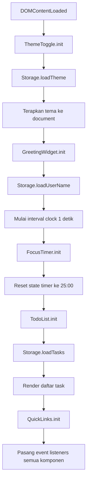

# Design Document: Todo Life Dashboard

## Overview

Todo Life Dashboard adalah aplikasi web satu halaman (SPA-lite) yang berjalan sepenuhnya di sisi klien — tanpa backend, tanpa build tools, tanpa framework JavaScript. Semua state dan data pengguna disimpan di `localStorage` browser.

Arsitektur dipilih sesederhana mungkin: satu file HTML, satu file CSS, satu file JS. Masing-masing memiliki tanggung jawab yang jelas dan terpisah sehingga mudah dibaca, dimodifikasi, dan dikembangkan lebih lanjut.

**Stack:**
- HTML5 semantik
- CSS3 dengan Custom Properties (variabel) untuk theming
- Vanilla JavaScript ES6+ (tanpa transpiler)
- Web Audio API untuk notifikasi audio timer
- `localStorage` untuk persistensi data

---

## Architecture

### Prinsip Desain

1. **Single Responsibility per File** — HTML hanya struktur, CSS hanya presentasi, JS hanya logika dan DOM manipulation.
2. **Module Pattern** — Setiap komponen besar dienkapsulasi dalam object/module di dalam file JS tunggal untuk menghindari polusi global namespace.
3. **Event-Driven** — Komponen berkomunikasi melalui event dan callback, bukan dependency langsung.
4. **localStorage sebagai Source of Truth** — Setiap operasi tulis ke state selalu diikuti write ke localStorage sebelum update UI.

### Struktur File

```
todo-life-dashboard/
├── index.html          ← Satu-satunya file HTML
├── css/
│   └── style.css       ← Semua styling, termasuk dark mode variables
└── js/
    └── app.js          ← Semua logika aplikasi
```

### Arsitektur Modul JavaScript

`app.js` diorganisasi menjadi beberapa modul/namespace yang di-initialize saat `DOMContentLoaded`:

```
app.js
├── Storage         ← Wrapper localStorage (get/set/remove dengan error handling)
├── GreetingWidget  ← Waktu, tanggal, sapaan, nama pengguna
├── FocusTimer      ← Pomodoro timer logic
├── TodoList        ← CRUD, sort, deduplicate tasks
├── QuickLinks      ← Static links (minimal logic)
├── ThemeToggle     ← Light/dark mode switch
└── App.init()      ← Bootstrap semua modul
```

### Diagram Alur Inisialisasi



---

## Components and Interfaces

### 1. GreetingWidget

**Tanggung Jawab:** Menampilkan jam, tanggal, sapaan kontekstual, dan nama pengguna.

**DOM Elements:**
```html
<section id="greeting-widget">
  <div id="clock">00:00:00</div>
  <div id="date-display">Senin, 01 Januari 2024</div>
  <div id="greeting-text">Selamat Pagi, Pengguna!</div>
  <div id="name-input-group">
    <input type="text" id="name-input" maxlength="50" placeholder="Masukkan nama Anda" />
    <button id="name-save-btn">Simpan</button>
    <span id="name-error" class="error-msg" aria-live="polite"></span>
  </div>
</section>
```

**Interface JS:**
```javascript
GreetingWidget = {
  init()           // Pasang event listener, mulai clock interval
  startClock()     // setInterval 1000ms → updateClock()
  updateClock()    // Update DOM jam & tanggal, panggil updateGreeting()
  formatTime(date) // → "HH:MM:SS"
  formatDate(date) // → "Kamis, 16 Oktober 2026"
  getGreeting(hour)// → "Selamat Pagi|Siang|Sore|Malam"
  updateGreeting() // Gabungkan sapaan + nama, update DOM
  saveName()       // Validasi input, simpan ke storage, update greeting
  loadName()       // Baca dari storage, update state internal
}
```

**Logika Sapaan:**
| Jam | Sapaan |
|-----|--------|
| 05:00 – 11:59 | Selamat Pagi |
| 12:00 – 14:59 | Selamat Siang |
| 15:00 – 17:59 | Selamat Sore |
| 18:00 – 04:59 | Selamat Malam |

---

### 2. FocusTimer

**Tanggung Jawab:** Pomodoro countdown 25 menit dengan kontrol start/stop/reset.

**DOM Elements:**
```html
<section id="focus-timer">
  <div id="timer-display">25:00</div>
  <div id="timer-controls">
    <button id="timer-start">Start</button>
    <button id="timer-stop" disabled>Stop</button>
    <button id="timer-reset">Reset</button>
  </div>
  <div id="timer-notification" class="hidden" role="alert">
    Sesi fokus selesai! Istirahatlah sejenak.
  </div>
</section>
```

**Interface JS:**
```javascript
FocusTimer = {
  state: { remaining: 1500, running: false, startTimestamp: null }
  
  init()             // Set initial display, pasang event listeners
  start()            // Catat startTimestamp, set interval, update button states
  stop()             // Clear interval, simpan remaining, update button states
  reset()            // Clear interval, remaining = 1500, update display
  tick()             // Hitung selisih waktu nyata, update remaining, cek selesai
  updateDisplay()    // Format MM:SS, update DOM
  handleComplete()   // Stop timer, tampilkan notifikasi, play audio
  playAudio()        // Web Audio API: beep sinusoidal
  syncOnVisibility() // Page Visibility API: koreksi drift saat tab aktif kembali
  updateButtonStates()// Toggle disabled/enabled berdasarkan state.running
}
```

**Logika Time Drift Correction:**

Daripada mengandalkan `setInterval` yang tidak akurat saat tab tidak aktif, timer menyimpan `startTimestamp` (Unix ms) saat dimulai dan menghitung sisa waktu sebagai:

```javascript
remaining = initialRemaining - Math.floor((Date.now() - startTimestamp) / 1000)
```

Saat tab aktif kembali (`visibilitychange`), nilai ini dihitung ulang secara instan.

---

### 3. TodoList

**Tanggung Jawab:** CRUD task lengkap — tambah, tampilkan, edit, toggle status, hapus, sort, deduplicate.

**DOM Elements:**
```html
<section id="todo-list">
  <div id="todo-input-group">
    <input type="text" id="task-input" maxlength="100" placeholder="Tambah task baru..." />
    <select id="priority-select">
      <option value="sedang" selected>Sedang</option>
      <option value="tinggi">Tinggi</option>
      <option value="rendah">Rendah</option>
    </select>
    <button id="task-add-btn">Tambah</button>
    <span id="task-error" class="error-msg" aria-live="polite"></span>
  </div>
  <div id="sort-controls">
    <button id="sort-status">Urutkan: Status</button>
    <button id="sort-priority">Urutkan: Prioritas</button>
  </div>
  <ul id="task-list" aria-label="Daftar tugas"></ul>
  <p id="empty-state" class="hidden">Daftar tugas kosong. Tambahkan task baru!</p>
</section>
```

**Template Task Item:**
```html
<!-- dirender via JS -->
<li class="task-item" data-id="{id}" data-completed="{bool}" data-priority="{priority}">
  <div class="task-check-group">
    <input type="checkbox" class="task-checkbox" id="check-{id}" aria-label="Tandai selesai: {text}" />
    <label for="check-{id}" class="task-text">{text}</label>
  </div>
  <div class="task-meta">
    <span class="priority-badge priority-{priority}">{priority}</span>
  </div>
  <div class="task-actions">
    <button class="task-edit-btn" aria-label="Edit task">Edit</button>
    <button class="task-delete-btn" aria-label="Hapus task">Hapus</button>
  </div>
</li>
```

**Interface JS:**
```javascript
TodoList = {
  state: { tasks: [], sortMode: 'status' }
  
  init()                  // Load dari storage, render, pasang event listeners
  addTask(text, priority) // Validasi → deduplicate → buat task object → simpan → render
  editTask(id, newText)   // Validasi → update task → simpan → render
  deleteTask(id)          // Hapus dari array → simpan → render
  toggleTask(id)          // Toggle completed → simpan → render
  renderTasks()           // Urutkan sesuai sortMode, buat DOM, tampilkan/sembunyikan empty state
  sortTasks(tasks)        // Kembalikan array terurut berdasarkan sortMode
  normalizeText(text)     // trim + lowercase + collapse whitespace → untuk deduplikasi
  isDuplicate(text)       // Cek apakah normalizeText(text) ada di state.tasks
  showError(msg)          // Tampilkan pesan error di #task-error, auto-hide 3 detik
  enterEditMode(id)       // Ubah item DOM ke mode edit (input + confirm + cancel)
  exitEditMode(id)        // Kembalikan item DOM ke mode tampilan normal
}
```

**Logika Urutan Sort:**

- **Sort by Status**: `incomplete` (0) sebelum `complete` (1); sama-sama incomplete/complete → urutan asli (insertion order).
- **Sort by Priority**: `tinggi` (0) > `sedang` (1) > `rendah` (2); jika prioritas sama → `incomplete` sebelum `complete`.

---

### 4. QuickLinks

**Tanggung Jawab:** Menampilkan tautan media sosial statis.

**DOM Elements:**
```html
<section id="quick-links">
  <a href="https://www.instagram.com/satriamahawira/" 
     target="_blank" rel="noopener noreferrer" class="quick-link link-instagram">
    <span class="link-icon" aria-hidden="true">📷</span>
    <span class="link-name">Instagram</span>
  </a>
  <a href="https://www.linkedin.com/in/satria-mahawira/" 
     target="_blank" rel="noopener noreferrer" class="quick-link link-linkedin">
    <span class="link-icon" aria-hidden="true">💼</span>
    <span class="link-name">LinkedIn</span>
  </a>
  <a href="https://www.facebook.com/mahawira.madesatria" 
     target="_blank" rel="noopener noreferrer" class="quick-link link-facebook">
    <span class="link-icon" aria-hidden="true">👤</span>
    <span class="link-name">Facebook</span>
  </a>
</section>
```

QuickLinks tidak memiliki state dinamis — semua tautan di-hardcode di HTML. Tidak ada logika JS yang diperlukan untuk komponen ini.

---

### 5. ThemeToggle

**Tanggung Jawab:** Beralih antara Light Mode dan Dark Mode, simpan preferensi ke localStorage.

**DOM Elements:**
```html
<button id="theme-toggle" aria-label="Toggle dark mode">
  <span id="theme-icon">🌙</span>
</button>
```

**Interface JS:**
```javascript
ThemeToggle = {
  state: { current: 'light' }
  
  init()          // Load tema dari storage, terapkan sebelum render konten lain
  toggle()        // Beralih antara 'light' dan 'dark', simpan, update DOM
  apply(theme)    // Set class/attribute pada document.documentElement
  save(theme)     // Simpan ke localStorage key 'theme'
  load()          // Baca dari localStorage, fallback ke 'light'
}
```

---

### 6. Storage

**Tanggung Jawab:** Abstraksi localStorage dengan error handling terpusat.

```javascript
Storage = {
  set(key, value)   // JSON.stringify + try/catch
  get(key, fallback) // JSON.parse + try/catch, kembalikan fallback jika error
  remove(key)       // try/catch
  isAvailable()     // Test localStorage tersedia dengan dummy write/read
}
```

---

## Data Models

### Task Object

Setiap task dalam array `tasks` di localStorage memiliki struktur:

```javascript
{
  id: string,          // UUID v4 atau timestamp-based unique string
  text: string,        // Teks task (1-100 karakter, sudah trim)
  completed: boolean,  // false = belum selesai, true = selesai
  priority: string,    // "tinggi" | "sedang" | "rendah"
  createdAt: number    // Unix timestamp (Date.now()) saat task dibuat
}
```

**Contoh:**
```json
{
  "id": "1729123456789-abc",
  "text": "Mengerjakan laporan akhir",
  "completed": false,
  "priority": "tinggi",
  "createdAt": 1729123456789
}
```

### localStorage Schema

| Key | Type | Default | Deskripsi |
|-----|------|---------|-----------|
| `tasks` | `Task[]` (JSON) | `[]` | Array semua task |
| `userName` | `string` | `"Pengguna"` | Nama pengguna untuk sapaan |
| `theme` | `"light" \| "dark"` | `"light"` | Preferensi tema |

---

## Layout & Wireframe

### Struktur HTML Utama

```html
<!DOCTYPE html>
<html lang="id" data-theme="light">
<head>...</head>
<body>
  <header>
    <h1 class="app-title">Todo Life Dashboard</h1>
    <button id="theme-toggle">🌙</button>
  </header>

  <main class="dashboard-grid">
    <!-- Kolom Kiri -->
    <div class="col-left">
      <section id="greeting-widget">...</section>
      <section id="focus-timer">...</section>
      <section id="quick-links">...</section>
    </div>

    <!-- Kolom Kanan -->
    <div class="col-right">
      <section id="todo-list">...</section>
    </div>
  </main>
</body>
</html>
```

### Wireframe Layout

```
┌─────────────────────────────────────────────────────┐
│  Todo Life Dashboard                    [🌙 Toggle] │
├──────────────────────┬──────────────────────────────┤
│  ┌────────────────┐  │  ┌──────────────────────────┐ │
│  │  Greeting      │  │  │  To-Do List              │ │
│  │  08:45:32      │  │  │  [Input Task ▼Prio] [+]  │ │
│  │  Kamis, 16 Okt │  │  │  [Sort: Status] [Prio]   │ │
│  │  Selamat Pagi  │  │  │  ─── Belum Selesai ───   │ │
│  │  Satria!       │  │  │  □ Laporan [tinggi] ✎ 🗑 │ │
│  │  [Nama] [Sim]  │  │  │  □ Meeting [sedang] ✎ 🗑 │ │
│  └────────────────┘  │  │  ─── Selesai ────────    │ │
│  ┌────────────────┐  │  │  ✓ Sarapan [rendah] ✎ 🗑 │ │
│  │  Focus Timer   │  │  └──────────────────────────┘ │
│  │     24:58      │  │                               │
│  │  [Start][Stop] │  │                               │
│  │     [Reset]    │  │                               │
│  └────────────────┘  │                               │
│  ┌────────────────┐  │                               │
│  │  Quick Links   │  │                               │
│  │  📷 Instagram  │  │                               │
│  │  💼 LinkedIn   │  │                               │
│  │  👤 Facebook   │  │                               │
│  └────────────────┘  │                               │
└──────────────────────┴──────────────────────────────┘
```

**Responsive Breakpoints:**
- **≥ 768px**: 2-column grid (kiri 35%, kanan 65%)
- **< 768px**: 1-column stack (greeting → timer → todo → quick links)
- **≥ 320px**: Semua konten fit tanpa horizontal scroll

---

## CSS Strategy

### CSS Custom Properties (Variabel Tema)

Semua warna didefinisikan sebagai CSS variables pada `:root` dan di-override pada `[data-theme="dark"]`:

```css
:root {
  /* Light Mode defaults */
  --bg-primary: #f8f9fa;
  --bg-secondary: #ffffff;
  --bg-widget: #ffffff;
  --text-primary: #212529;
  --text-secondary: #6c757d;
  --text-muted: #adb5bd;
  --accent-color: #4361ee;
  --accent-hover: #3a56d4;
  --border-color: #dee2e6;
  --shadow: 0 2px 8px rgba(0, 0, 0, 0.08);
  --completed-text: #adb5bd;
  
  /* Priority badge colors */
  --priority-tinggi: #ef233c;
  --priority-sedang: #f48c06;
  --priority-rendah: #52b788;
  
  /* Timer notification */
  --notification-bg: #d8f3dc;
  --notification-text: #1b4332;
  
  /* Transitions */
  --transition-fast: 150ms ease;
  --transition-medium: 300ms ease;
}

[data-theme="dark"] {
  --bg-primary: #0f172a;
  --bg-secondary: #1e293b;
  --bg-widget: #1e293b;
  --text-primary: #f1f5f9;
  --text-secondary: #94a3b8;
  --text-muted: #475569;
  --accent-color: #60a5fa;
  --accent-hover: #93c5fd;
  --border-color: #334155;
  --shadow: 0 2px 8px rgba(0, 0, 0, 0.4);
  --completed-text: #475569;
  --notification-bg: #1b4332;
  --notification-text: #d8f3dc;
}
```

**Penerapan tema:** Toggle theme dengan mengubah atribut `data-theme` pada `<html>`:
```javascript
document.documentElement.setAttribute('data-theme', theme)
```

Tidak menggunakan class toggle untuk menghindari specificity issues.

### Layout CSS

```css
/* Header */
header {
  display: flex;
  justify-content: space-between;
  align-items: center;
}

/* Main grid */
.dashboard-grid {
  display: grid;
  grid-template-columns: 35% 1fr;
  gap: 1.5rem;
}

/* Responsive */
@media (max-width: 768px) {
  .dashboard-grid {
    grid-template-columns: 1fr;
  }
}
```

### Task Completed State

```css
.task-item[data-completed="true"] .task-text {
  text-decoration: line-through;
  color: var(--completed-text);
  transition: color var(--transition-fast), text-decoration var(--transition-fast);
}
```

### Priority Badge

```css
.priority-badge {
  font-size: 0.7rem;
  padding: 2px 6px;
  border-radius: 9999px;
  font-weight: 600;
  text-transform: capitalize;
}
.priority-badge.priority-tinggi { background: var(--priority-tinggi); color: #fff; }
.priority-badge.priority-sedang { background: var(--priority-sedang); color: #fff; }
.priority-badge.priority-rendah { background: var(--priority-rendah); color: #fff; }
```

---

## Correctness Properties

*A property is a characteristic or behavior that should hold true across all valid executions of a system — essentially, a formal statement about what the system should do. Properties serve as the bridge between human-readable specifications and machine-verifiable correctness guarantees.*

---

### Property 1: Greeting Format Sesuai Jam

*For any* jam dalam rentang 0–23, fungsi `getGreeting(hour)` harus mengembalikan tepat satu dari empat sapaan yang valid, dan setiap jam harus dipetakan ke sapaan yang tepat sesuai aturan bisnis (05–11 → Pagi, 12–14 → Siang, 15–17 → Sore, 18–23 dan 0–4 → Malam).

**Validates: Requirements 1.3, 1.4, 1.5, 1.6**

---

### Property 2: Format Output Waktu Valid

*For any* objek `Date` yang valid, `formatTime(date)` harus menghasilkan string yang cocok dengan pola `HH:MM:SS` di mana setiap komponen adalah angka dua digit (00–23 untuk jam, 00–59 untuk menit dan detik).

**Validates: Requirements 1.1**

---

### Property 3: Format Output Tanggal Valid dalam Bahasa Indonesia

*For any* objek `Date` yang valid, `formatDate(date)` harus menghasilkan string yang mengandung nama hari dalam Bahasa Indonesia yang valid (Senin, Selasa, Rabu, Kamis, Jumat, Sabtu, atau Minggu) dan nama bulan dalam Bahasa Indonesia yang valid (Januari – Desember).

**Validates: Requirements 1.2**

---

### Property 4: Penyimpanan Nama Pengguna yang Valid

*For any* string nama yang valid (panjang 1–50 karakter, tidak hanya whitespace), setelah memanggil fungsi save, `localStorage.getItem('userName')` harus mengembalikan tepat nama tersebut setelah di-trim.

**Validates: Requirements 2.2**

---

### Property 5: Penolakan Nama Tidak Valid

*For any* string yang seluruhnya terdiri dari karakter whitespace (spasi, tab, newline), atau string yang panjangnya melebihi 50 karakter, fungsi save nama harus menolak input dan nilai di localStorage harus tetap tidak berubah dari nilai sebelumnya.

**Validates: Requirements 2.4, 2.7**

---

### Property 6: Timer Reset Selalu ke 1500 Detik

*For any* state timer (berjalan maupun berhenti, dengan sisa waktu berapapun), setelah memanggil `reset()`, nilai `state.remaining` harus sama dengan 1500 (25 menit × 60 detik) dan `state.running` harus `false`.

**Validates: Requirements 3.5**

---

### Property 7: Koreksi Drift Timer Berdasarkan Waktu Nyata

*For any* durasi yang telah berlalu (dalam detik) sejak timer dimulai, nilai `remaining` yang dihitung ulang harus sama dengan `initialRemaining - elapsedSeconds` (dibulatkan ke bawah), sehingga waktu yang ditampilkan selalu mencerminkan waktu nyata yang berlalu.

**Validates: Requirements 3.10**

---

### Property 8: Task Baru Selalu Dibuat dengan Status Belum Selesai

*For any* teks task yang valid (1–100 karakter, bukan hanya whitespace, tidak duplikat) dan nilai prioritas yang valid, task yang dibuat harus memiliki `completed: false` dan nilai prioritas tersebut (atau "sedang" jika tidak diberikan).

**Validates: Requirements 4.2, 12.6**

---

### Property 9: Round-Trip Persistensi Task

*For any* operasi task (tambah, edit, toggle, hapus), setelah operasi selesai, hasil `JSON.parse(localStorage.getItem('tasks'))` harus mencerminkan state array tasks yang terkini persis sebelum render dilakukan — tidak ada task yang hilang, ditambahkan, atau dimodifikasi secara tidak sengaja.

**Validates: Requirements 4.3, 5.4, 6.4, 7.3, 8.1**

---

### Property 10: Penolakan Task Tidak Valid

*For any* string yang seluruhnya terdiri dari whitespace, atau string yang panjangnya lebih dari 100 karakter, fungsi `addTask` harus menolak input dan panjang array `state.tasks` harus tetap tidak berubah.

**Validates: Requirements 4.5**

---

### Property 11: Deduplication Berbasis Normalisasi

*For any* teks task yang ada dalam daftar, mencoba menambahkan teks yang identik setelah normalisasi (trim + lowercase + collapse whitespace ke satu spasi) harus gagal — array tasks tidak boleh bertambah panjangnya, dan task duplikat tidak boleh ada di storage.

**Validates: Requirements 4.6, 11.1, 11.2, 11.3**

---

### Property 12: Toggle Status Task

*For any* task dalam daftar, setelah satu kali toggle, `completed` berubah ke nilai berlawanan. Setelah dua kali toggle berturut-turut, `completed` kembali ke nilai semula (round-trip).

**Validates: Requirements 6.2, 6.3**

---

### Property 13: Task Terhapus Tidak Ada dalam Daftar

*For any* task yang ada di `state.tasks`, setelah memanggil `deleteTask(id)`, task dengan `id` tersebut tidak boleh lagi ditemukan di `state.tasks` maupun di `localStorage`.

**Validates: Requirements 7.2, 7.3**

---

### Property 14: Sort by Status — Incomplete Selalu di Atas

*For any* array tasks yang berisi campuran task selesai dan belum selesai, setelah pengurutan berdasarkan status, tidak boleh ada task dengan `completed: true` yang posisinya mendahului task dengan `completed: false`.

**Validates: Requirements 6.6, 12.1, 12.3**

---

### Property 15: Sort by Priority — Urutan Prioritas Terjaga

*For any* array tasks yang berisi campuran prioritas, setelah pengurutan berdasarkan prioritas, untuk setiap pasang task A dan B dimana A memiliki prioritas lebih rendah dari B, A tidak boleh muncul sebelum B dalam daftar hasil.

**Validates: Requirements 12.2, 12.4**

---

### Property 16: Sort by Priority — Secondary Sort by Status

*For any* dua task dengan prioritas yang sama, setelah pengurutan berdasarkan prioritas, task dengan `completed: false` harus selalu muncul sebelum task dengan `completed: true`.

**Validates: Requirements 12.8**

---

### Property 17: Theme Toggle Round-Trip

*For any* theme yang aktif saat ini ("light" atau "dark"), setelah satu kali toggle, tema yang diterapkan adalah kebalikannya, dan setelah dua kali toggle, tema kembali ke nilai semula. Nilai yang tersimpan di localStorage harus selalu sinkron dengan tema yang diterapkan.

**Validates: Requirements 10.2, 10.3**

---

### Property 18: Fallback Default untuk Data localStorage yang Hilang

*For any* kombinasi kunci localStorage yang hilang (`tasks`, `userName`, `theme`), fungsi `Storage.get(key, fallback)` harus mengembalikan nilai `fallback` yang diberikan — bukan `null`, bukan `undefined`, dan tidak melempar exception.

**Validates: Requirements 8.6, 10.5**

---

## Error Handling

### Kategori Error

| Kategori | Contoh | Penanganan |
|----------|--------|------------|
| **Input Validation** | Nama kosong, task kosong, nama >50 char | Tampilkan error message inline di dekat input, jangan simpan |
| **Duplicate Detection** | Task teks sama sudah ada | Tampilkan warning, pertahankan teks di input, auto-dismiss 3 detik |
| **Storage Failure** | localStorage penuh, blocked by browser | Tampilkan error banner, operasi in-memory tetap berjalan |
| **Timer Error** | Interval error | Pertahankan nilai terakhir, hentikan pembaruan, jangan throw ke user |
| **Page Load Failure** | CSS/JS gagal dimuat | HTML dasar tetap terlihat dan terbaca |

### Error Display Pattern

```javascript
// Semua error ditampilkan sebagai inline message, bukan alert/confirm
function showError(elementId, message, autoDismissMs = 3000) {
  const el = document.getElementById(elementId)
  el.textContent = message
  el.classList.remove('hidden')
  if (autoDismissMs) {
    setTimeout(() => {
      el.textContent = ''
      el.classList.add('hidden')
    }, autoDismissMs)
  }
}
```

Error tidak pernah menggunakan `window.alert()` atau `window.confirm()` karena mengganggu UX.

### Storage Error Handling

```javascript
Storage = {
  set(key, value) {
    try {
      localStorage.setItem(key, JSON.stringify(value))
      return true
    } catch (e) {
      // QuotaExceededError atau SecurityError
      showError('storage-error', 'Perubahan tidak dapat disimpan. Penyimpanan browser penuh atau diblokir.')
      return false
    }
  },
  get(key, fallback = null) {
    try {
      const item = localStorage.getItem(key)
      return item !== null ? JSON.parse(item) : fallback
    } catch (e) {
      return fallback
    }
  }
}
```

---

## Testing Strategy

### Pendekatan Dual Testing

Strategi pengujian menggunakan dua lapisan yang saling melengkapi:

1. **Unit Tests (Example-Based)** — Menguji skenario spesifik, edge case, dan kondisi error dengan contoh konkret.
2. **Property-Based Tests (PBT)** — Menguji 18 correctness properties di atas terhadap ratusan input yang di-generate secara acak.

### Library Property-Based Testing

Karena project ini menggunakan Vanilla JavaScript, gunakan **[fast-check](https://github.com/dubzzz/fast-check)** sebagai library PBT:

```bash
# Untuk testing saja (tidak masuk production bundle)
npm install --save-dev fast-check
```

Setiap property test dikonfigurasi dengan minimum **100 iterasi**.

### Tag Format untuk Property Tests

Setiap property test diberi komentar tag agar mudah dilacak:

```javascript
// Feature: todo-life-dashboard, Property 1: getGreeting maps hour to correct salutation
it('should return correct greeting for any hour', () => {
  fc.assert(fc.property(
    fc.integer({ min: 5, max: 11 }),
    (hour) => getGreeting(hour) === 'Selamat Pagi'
  ), { numRuns: 100 })
})
```

### Struktur Test

```
tests/
├── unit/
│   ├── greeting.test.js     ← Unit tests GreetingWidget
│   ├── timer.test.js        ← Unit tests FocusTimer
│   ├── todo.test.js         ← Unit tests TodoList
│   ├── storage.test.js      ← Unit tests Storage module
│   └── theme.test.js        ← Unit tests ThemeToggle
└── property/
    ├── greeting.prop.test.js ← Properties 1, 2, 3, 4, 5
    ├── timer.prop.test.js    ← Properties 6, 7
    ├── todo.prop.test.js     ← Properties 8–16
    └── theme.prop.test.js    ← Properties 17, 18
```

### Unit Test Coverage (Example-Based)

**GreetingWidget:**
- Nama default "Pengguna" ketika localStorage kosong
- Sapaan diperbarui tanpa reload setelah nama disimpan
- Clock interval berjalan setiap 1000ms

**FocusTimer:**
- Tampilan awal "25:00"
- Tombol Start disabled saat timer berjalan
- Notifikasi visual tampil ≥3 detik saat countdown selesai
- Audio beep dipanggil saat sesi selesai

**TodoList:**
- Input dikosongkan setelah task ditambahkan
- Warning duplikasi auto-dismiss setelah 3 detik
- Pesan empty state muncul saat semua task dihapus
- Edit mode menampilkan hanya tombol konfirmasi dan batal
- Pembatalan edit mempertahankan teks asli

**Storage:**
- `isAvailable()` mengembalikan `false` saat localStorage diblokir
- `get()` mengembalikan fallback untuk JSON yang tidak valid

**ThemeToggle:**
- Tema Light digunakan sebagai default
- `data-theme` attribute pada `<html>` berubah sesuai tema
- Tidak ada flicker saat halaman dimuat (tema diterapkan sebelum render)

### Integration / Smoke Tests

| Test | Tipe | Deskripsi |
|------|------|-----------|
| Data task bertahan setelah reload | Integration | Save tasks, reload page, verify tasks present |
| Tema bertahan setelah reload | Integration | Save theme, reload, verify same theme active |
| Nama bertahan setelah reload | Integration | Save name, reload, verify greeting shows name |
| Dibuka via `file://` | Smoke | All features work without HTTP server |
| Cross-browser rendering | Smoke | Manual: Chrome, Firefox, Edge, Safari latest |
| Responsive layout 320px | Smoke | No horizontal scroll at minimum width |
